<p align="center">
  <a href="https://mohamedadelrr.github.io"><picture><source media="(prefers-color-scheme: dark)" srcset="assets/banner-dark.svg"><source media="(prefers-color-scheme: light)" srcset="assets/banner-light.svg"></picture></a>
</p>

<p align="center">
  <a href="https://mohamedadelrr.github.io"><b>Portfolio</b></a> &nbsp;·&nbsp;
  <a href="https://mohamedadelrr.github.io/ar.html">بالعربي</a> &nbsp;·&nbsp;
  <a href="#work">Work</a> &nbsp;·&nbsp;
  <a href="#recognition">Recognition</a> &nbsp;·&nbsp;
  <a href="#stack">Stack</a> &nbsp;·&nbsp;
  <a href="#contact">Contact</a>
</p>

I design and build software that has to work in the real world: school portals used by thousands of parents, lecture apps for a university, and machines that sense and act. I study and teach Information Technology, and I like being close to the whole system, from the database to the circuit board.

```js
const mohamed = {
  base: "Alexandria, Egypt",
  now: ["Teaching Assistant, BATU", "IT Manager and Web Developer, Ahmed Zewail School"],
  focus: ["web systems", "mobile apps", "embedded hardware"],
  languages: ["Arabic", "English"],
};
```

<a id="now"></a>
## ./currently

<p align="center"><picture><source media="(prefers-color-scheme: dark)" srcset="assets/now-dark.svg"><source media="(prefers-color-scheme: light)" srcset="assets/now-light.svg">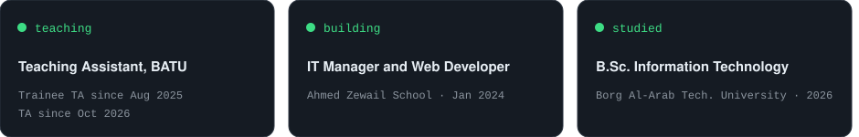</picture></p>

<a id="work"></a>
## ./selected-work

<table>
<tr><td><a href="https://mohamedadelrr.github.io/#work"><picture><source media="(prefers-color-scheme: dark)" srcset="assets/card-smart-attendance-dark.svg"><source media="(prefers-color-scheme: light)" srcset="assets/card-smart-attendance-light.svg">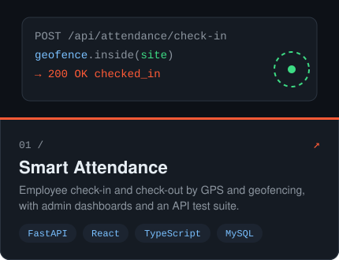</picture></a></td><td><a href="https://mohamedadelrr.github.io/#work"><picture><source media="(prefers-color-scheme: dark)" srcset="assets/card-atlas-smartpump-dark.svg"><source media="(prefers-color-scheme: light)" srcset="assets/card-atlas-smartpump-light.svg">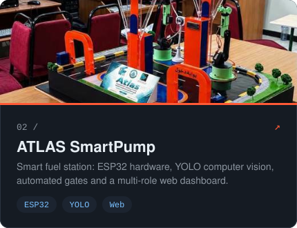</picture></a></td></tr>
<tr><td><a href="https://mohamedadelrr.github.io/#work"><picture><source media="(prefers-color-scheme: dark)" srcset="assets/card-cd-3-machine-dark.svg"><source media="(prefers-color-scheme: light)" srcset="assets/card-cd-3-machine-light.svg">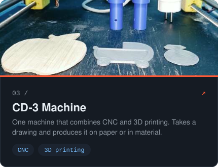</picture></a></td><td><a href="https://mohamedadelrr.github.io/#work"><picture><source media="(prefers-color-scheme: dark)" srcset="assets/card-robot-apms-dark.svg"><source media="(prefers-color-scheme: light)" srcset="assets/card-robot-apms-light.svg">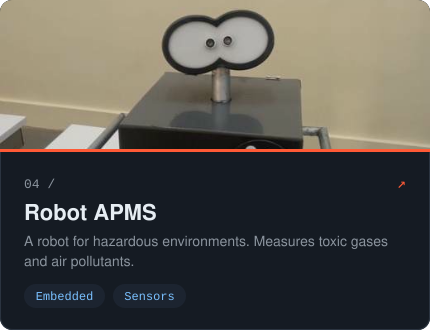</picture></a></td></tr>
<tr><td><a href="https://mohamedadelrr.github.io/#work"><picture><source media="(prefers-color-scheme: dark)" srcset="assets/card-ulms-desktop-app-dark.svg"><source media="(prefers-color-scheme: light)" srcset="assets/card-ulms-desktop-app-light.svg">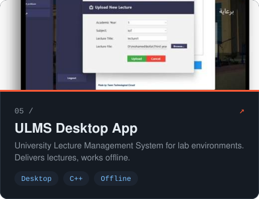</picture></a></td><td><a href="https://mohamedadelrr.github.io/#work"><picture><source media="(prefers-color-scheme: dark)" srcset="assets/card-lecturemate-dark.svg"><source media="(prefers-color-scheme: light)" srcset="assets/card-lecturemate-light.svg">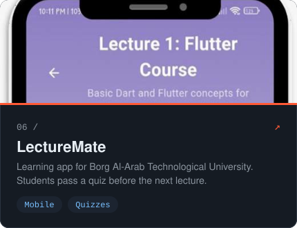</picture></a></td></tr>
</table>

<sub>Most of this work is for schools and a university, so the code is private. See each project on the <a href="https://mohamedadelrr.github.io/#work">portfolio</a>.</sub>

<a id="recognition"></a>
## ./recognition

<p align="center"><picture><source media="(prefers-color-scheme: dark)" srcset="assets/awards-dark.svg"><source media="(prefers-color-scheme: light)" srcset="assets/awards-light.svg">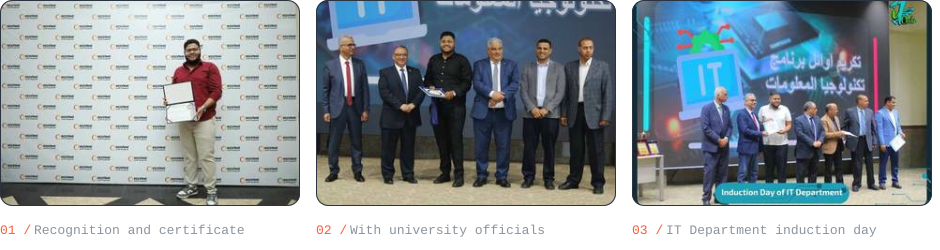</picture></p>

<a id="stack"></a>
## ./stack

<p align="center"><picture><source media="(prefers-color-scheme: dark)" srcset="assets/stack-dark.svg"><source media="(prefers-color-scheme: light)" srcset="assets/stack-light.svg">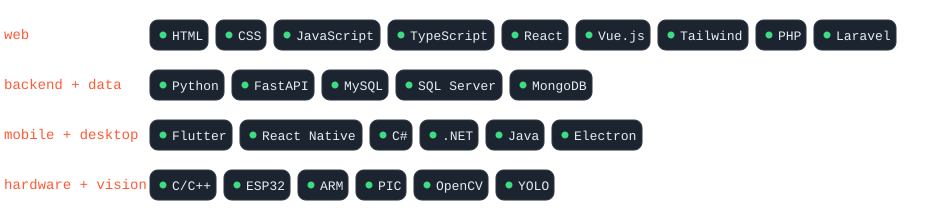</picture></p>

<a id="contact"></a>
## ./contact

<p>
  <a href="https://mohamedadelrr.github.io"><picture><source media="(prefers-color-scheme: dark)" srcset="assets/btn-portfolio-dark.svg"><source media="(prefers-color-scheme: light)" srcset="assets/btn-portfolio-light.svg">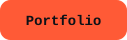</picture></a>
  <a href="mailto:mt3182002@gmail.com"><picture><source media="(prefers-color-scheme: dark)" srcset="assets/btn-email-dark.svg"><source media="(prefers-color-scheme: light)" srcset="assets/btn-email-light.svg">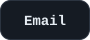</picture></a>
  <a href="https://linkedin.com/in/mohamed-adel-812201ma"><picture><source media="(prefers-color-scheme: dark)" srcset="assets/btn-linkedin-dark.svg"><source media="(prefers-color-scheme: light)" srcset="assets/btn-linkedin-light.svg">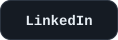</picture></a>
  <a href="https://github.com/mohamedadelrr"><picture><source media="(prefers-color-scheme: dark)" srcset="assets/btn-github-dark.svg"><source media="(prefers-color-scheme: light)" srcset="assets/btn-github-light.svg"></picture></a>
</p>
